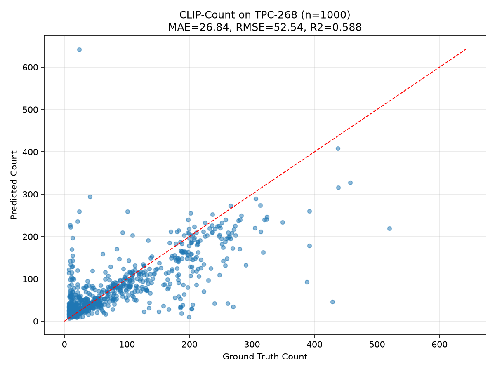
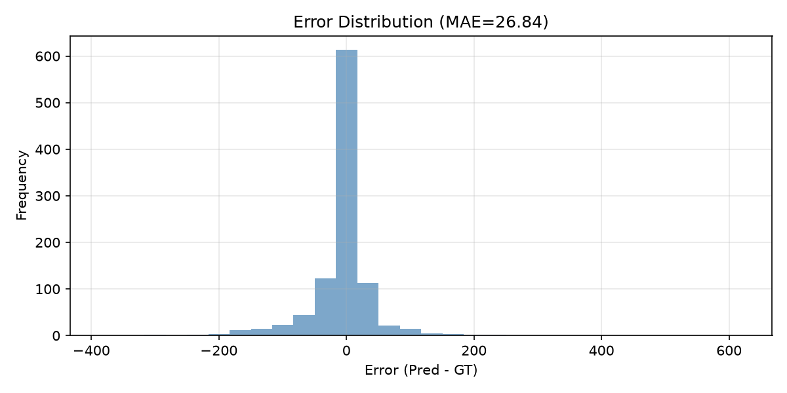
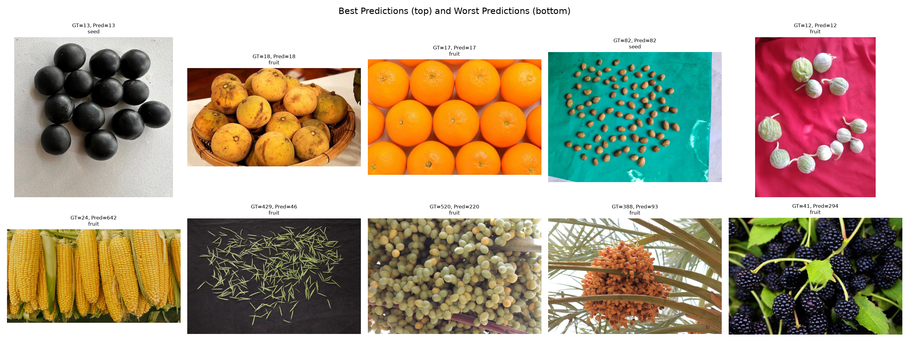
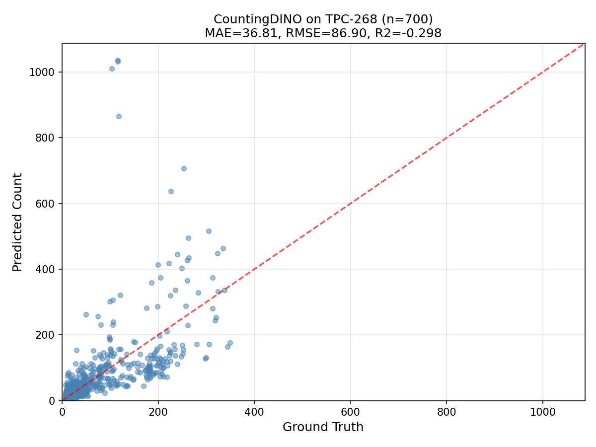
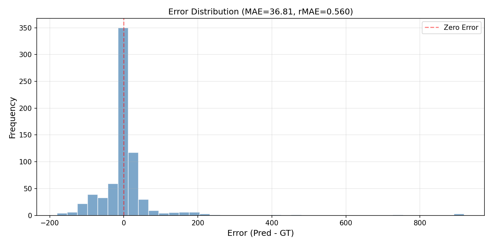
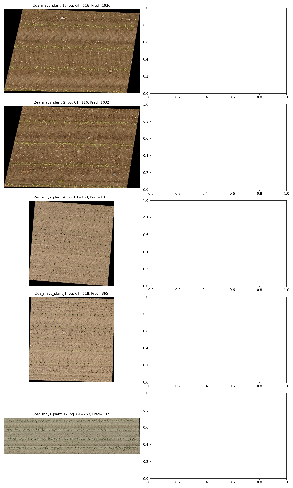
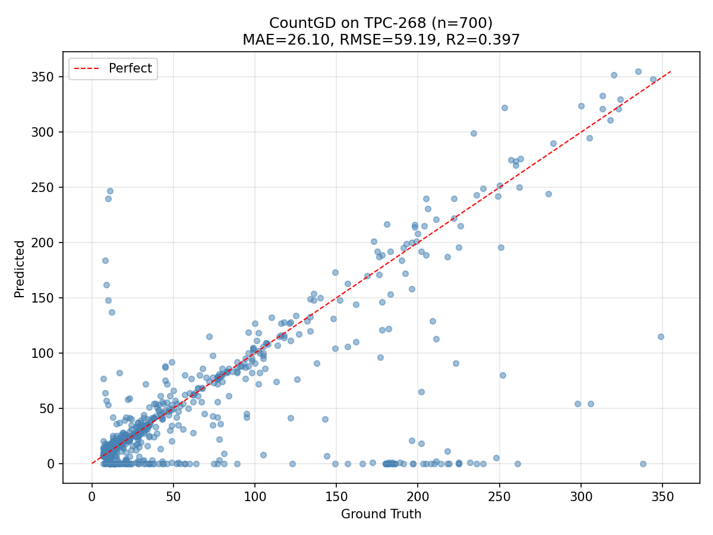
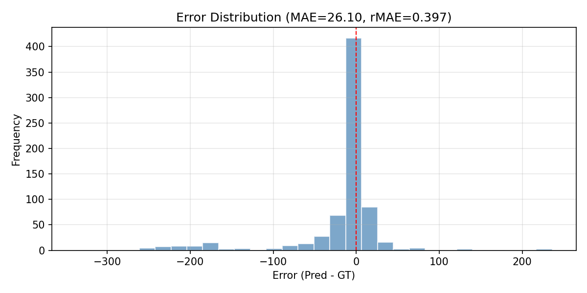
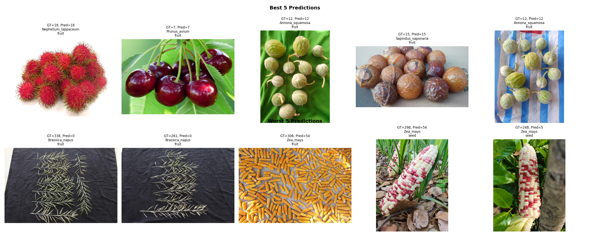

# 多模态植物计数 —— 模式识别与机器学习课程设计项目

> **Multimodal Plant Counting** — Pattern Recognition & Machine Learning Course Project
>
> 本项目的目标是通过多种计算机视觉方法（CLIP-Count、CountingDINO、CountGD）实现对不同种类植物的计数，
> 探索在TPC-268下品种无关的植物计数能力。

---

## 目录

- [项目背景](#项目背景)
- [环境要求与安装](#环境要求与安装)
- [数据集](#数据集)
- [基线方法](#基线方法)
- [文件结构](#文件结构)
- [快速开始](#快速开始)
- [实验结果](#实验结果)
- [跨基线对比分析](#跨基线对比分析)
- [参考文献](#参考文献)

---

## 项目背景

本课程设计基于 [TPC-268](https://github.com/tiny-smart/TPC-268) 数据集构建植物计数系统。
我们收集了荧光（Fluorescence）、红外（Infrared）、MRI 三种模态的数据，涵盖约 5 种植物，
约 226 张图像（TEC-030 数据集）。同时复现和评估了三种主流类别无关计数基线：

1. **CLIP-Count**（密度图回归，text-guided，CVPR 2024）
2. **CountingDINO**（样例引导特征匹配，training-free，WACV 2026）
3. **CountGD**（多模态开放世界计数，GroundingDINO + SAM，NeurIPS 2024）

三种基线分别代表"文本引导密度图回归"、"样例引导特征匹配"和"开放词汇检测+分割"三种不同的计数范式，
对其在植物图像上的表现进行了多维度（MAE、RMSE、R2、rMAE、rRMSE、FLOPS）的定量评估与深层原因分析。

---

## 环境要求与安装

### 系统要求

- Python >= 3.8
- PyTorch >= 1.10
- CUDA >= 11.3

### 安装步骤

```bash
# 1. 克隆项目
git clone <your-repo-url>
cd plant_counting

# 2. 创建虚拟环境（推荐）
python -m venv venv
source venv/bin/activate  # Linux/Mac
# 或 venv\Scripts\activate  # Windows

# 3. 安装各基线依赖（根据需要选择）
pip install -r baselines/clip_count/requirements.txt
pip install ultralytics  # YOLO-World / 其他 ultralytics 模型（可选）
```

### 预训练权重

从以下链接下载预训练权重并放入 `weights/` 目录：

| 模型 | 权重文件 | 下载链接 |
|------|---------|---------|
| CLIP-Count | `clip_count_pretrained.ckpt` | [Google Drive](https://drive.google.com/file/d/17Dj0tjd29lPGOGYEF5IrE8aPClXUjTrR/view) |
| GroundingDINO | `groundingdino_swint_ogc.pth` | [GitHub Release](https://github.com/IDEA-Research/GroundingDINO/releases) |
| GroundingDINO Swin-B | `groundingdino_swinb_cogcoor.pth` | [GitHub Release](https://github.com/IDEA-Research/GroundingDINO/releases) |
| CountGD | `checkpoint_fsc147_best.pth` | [Google Drive](https://drive.google.com/file/d/1RbRcNLsOfeEbx6u39pBehqsgQiexHHrI/view) |
| CLIP ViT-B/16 | `ViT-B-16.pt` | OpenAI CLIP |
| DINOv2 ViT-B/14 | `dinov2_vitb14_reg4_pretrain.pth` | 自动下载至 torch hub 缓存 |
| DINOv2 ViT-L/14 | `dinov2_vitl14_reg4_pretrain.pth` | 自动下载至 torch hub 缓存 |
| BERT (CountGD) | `bert-base-uncased` | 自动下载（通过 `download_bert.py`） |

---

## 数据集

### TPC-268（参考数据集）

[TPC-268](https://github.com/tiny-smart/TPC-268) 是一个包含 268 种植物、 
有10,000 张图像的大规模品种无关植物计数数据集。

- 论文: [TPC-268: A Large-Scale Dataset for Plant Counting](https://arxiv.org/abs/2603.21229)
- 项目主页: https://tiny-smart.github.io/tpc268-project-page
- 代码仓库: https://github.com/tiny-smart/TPC-268

### TEC-030（自收集数据）

我们在 `TEC-030/` 目录下收集了三种模态的植物计数数据,有30种物种以及：

- **荧光 (Fluorescence)**：`TEC-030/{species}/Fluorescence/`
- **红外 (Infrared)**：`TEC-030/{species}/Infrared/`
- **MRI**：待收集

目前已有约 5 种植物（向日葵、荞麦、菜豆、狗尾草、高粱）的基础图像数据，共约 226 张。

---

## 基线方法

本项目实现了三种基线方法，均保存在 `baselines/` 目录下：

### 1. CLIP-Count

> **论文**: [CLIP-Count: Towards Text-Guided Object Counting](https://arxiv.org/abs/2401.06415) (CVPR 2024)
>
> **代码**: [https://github.com/Yiming-Lin/CLIP-Count](https://github.com/Yiming-Lin/CLIP-Count)

基于 CLIP 视觉-语言模型的零样本计数方法。通过计算图像与文本提示之间的相似度生成密度图，
再对密度图积分得到计数。**本项目中 R2 最高的基线。**

| 配置 | 值 |
|------|----|
| 骨干网络 | CLIP ViT-B/16 + CrossViT |
| 输入分辨率 | 384 × 384 |
| 参数量 | ~350M |
| 推断 FLOPS | ~300 GFLOPs/图（估） |
| 计数范式 | 文本引导 → 密度图回归 → 积分 |

### 2. CountingDINO

> **论文**: [CountingDINO: A Training-free Pipeline for Class-Agnostic Counting using Unsupervised Backbones](https://arxiv.org/abs/2401.06415) (WACV 2026)
>
> **代码**: [https://github.com/lorebianchi98/CountingDINO](https://github.com/lorebianchi98/CountingDINO)

基于 DINOv2 自监督视觉特征的训练无关计数方法。通过卷积特征匹配进行样例引导的密度估计。

| 配置 | 值 |
|------|----|
| 骨干网络 | DINOv2 ViT-B/14 (with registers) |
| 输入分辨率 | 840 × 840 |
| 参数量 | 87M |
| 推断 FLOPS | ~2130 GFLOPs/图 |
| 计数范式 | 样例框引导 → DINO 特征匹配 → 密度估计 |
| 样例数 | 3 个 |

### 3. CountGD

> **论文**: [CountGD: Multi-Modal Open-World Counting](https://arxiv.org/abs/2407.04619) (NeurIPS 2024)
>
> **代码**: [https://github.com/niki-amini-naieni/CountGD](https://github.com/niki-amini-naieni/CountGD)

基于 GroundingDINO 开放词汇检测器与 SAM（Segment Anything Model）的多模态计数方法。
同时支持文本提示和视觉样例两种输入模式，通过检测-分割-计数 pipeline 完成开放世界物体计数。
**本项目中 MAE 最低的基线。**

| 配置 | 值 |
|------|----|
| 骨干网络 | GroundingDINO Swin-B + SAM ViT-H |
| 输入分辨率 | 动态（保持宽高比，长边缩放至目标尺寸） |
| 参数量 | ~1B+ (GroundingDINO ~172M + SAM ~636M) |
| 推断 FLOPS | ~3500 GFLOPs/图（估） |
| 计数范式 | 开放词汇检测 → SAM 分割 → per-prompt 计数 |
| 置信度阈值 | 0.23 |

---

## 文件结构

```
plant_counting/
├── .gitignore                      # Git 忽略规则（忽略 weights/ TEC-030/ TPC-268/ results/ logs/）
├── README.md                       # 本文件说明
├── baselines/                      # 基线方法代码
│   ├── clip_count/                 # CLIP-Count 基线（密度图回归）
│   ├── countingdino/               # CountingDINO 基线（训练无关特征匹配）
│   └── countgd/                    # CountGD 基线（多模态开放世界计数）
├── pacnet/                     # **改进算法：PACNet（Plant-Adaptive Counting Network）**
│   ├── models/                     #   模型代码（PACNet、Backbone、密度头、TasselNet网格计数、损失）
│   ├── datasets/                   #   数据集加载（TPC-268 + 密度图生成）
│   ├── utils/                      #   评估指标、可视化、密度图生成工具
│   ├── config/                     #   训练配置
│   ├── train.py                    #   训练入口
│   ├── evaluate.py                 #   评估入口
│   └── inference.py                #   单图推理
├── app/                            # **人机交互界面**
│   ├── app.py                      #   Flask 后端（支持 CLIP-Count / PACNet 推理）
│   ├── templates/index.html        #   响应式前端界面
│   └── README.md                   #   使用说明
├── TEC-030/                        # 自收集的多模态数据
│   ├── Helianthus annuus/          #   向日葵（叶片，荧光/红外）
│   ├── Fagopyrum esculentum/       #   荞麦（花/叶，荧光/红外）
│   ├── Phaseolus vulgaris/         #   菜豆（叶片，荧光/红外）
│   ├── Setaria viridis/            #   狗尾草（叶片，荧光/红外）
│   └── Sorghum bicolor/            #   高粱（花/叶，荧光/红外）
│   ├── Helianthus annuus/          #   向日葵
│   ├── Fagopyrum esculentum/       #   荞麦
│   ├── Phaseolus vulgaris/         #   菜豆
│   ├── Setaria viridis/            #   狗尾草
│   └── Sorghum bicolor/            #   高粱
├── TPC-268/                        # TPC-268 数据集图像（10K 张，268 种植物）
├── TPC-268-main/                   # TPC-268 官方代码仓库（标注文件、划分列表、工具）
├── weights/                        # 预训练权重
├── results/                        # 评估结果
│   ├── clip_count/                 #   CLIP-Count 评估结果
│   │   ├── metrics.txt             #     量化指标
│   │   ├── predictions.csv         #     逐样本预测
│   │   ├── scatter_plot.png        #     散点图
│   │   └── error_histogram.png     #     误差分布直方图
│   └── countingdino/               #   CountingDINO 评估结果
│       ├── metrics.txt             #     量化指标
│       ├── predictions.csv         #     逐样本预测
│       ├── scatter_plot.png        #     散点图
│       ├── error_histogram.png     #     误差分布直方图
│       └── error_case_examples.png #     最差 5 个案例可视化
│   └── countgd/                    #   CountGD 评估结果
│       ├── metrics.txt             #     量化指标
│       ├── predictions.csv         #     逐样本预测
│       ├── scatter_plot.png        #     散点图
│       ├── error_histogram.png     #     误差分布直方图
│       └── example_predictions.png #     示例预测可视化
├── scripts/                        # 评估脚本
│   ├── evaluate_clip_count.py      #   CLIP-Count 评估
│   └── evaluate_countingdino.py    #   CountingDINO 评估
└── logs/                           # 训练日志
```

---

## 快速开始

### 评估 CLIP-Count

```bash
python scripts/evaluate_clip_count.py --num_images 100
```

可选参数：
- `--num_images`：测试图像数量（默认 100，设为 -1 测试全部）
- `--output_dir`：结果输出目录（默认 `results/clip_count`）
- `--seed`：随机种子（默认 42，用于随机选择数据集中图像进行训练）

### 评估 CountingDINO

```bash
python scripts/evaluate_countingdino.py --num_images 100 --model_name dinov2_vitb14_reg
```

可选参数：
- `--model_name`：骨干网络（默认 `dinov2_vitb14_reg`，可选 `dinov2_vitl14_reg`）
- `--num_images`：测试图像数量（默认 700）
- `--output_dir`：结果输出目录（默认 `results/countingdino`）
- `--seed`：随机种子（默认 42，用于随机选择数据集中图像进行训练）

### 评估 CountGD

```bash
python -u baselines/countgd/main_inference.py \
    --output_dir ./results/countgd \
    -c baselines/countgd/config/cfg_fsc147_vit_b_test.py \
    --eval \
    --datasets config/datasets_fsc147_test.json \
    --pretrain_model_path checkpoints/checkpoint_fsc147_best.pth \
    --options text_encoder_type=checkpoints/bert-base-uncased \
    --crop --remove_bad_exemplar
```

> **注意**：CountGD 推理需先配置 GroundingDINO 的 CUDA 算子（`cd models/GroundingDINO/ops && python setup.py build install`），并下载 GroundingDINO Swin-B、SAM ViT-H 及 CountGD 预训练权重。具体步骤参考 `baselines/countgd/README.md`。

---

## 实验结果

### CLIP-Count on TPC-268（100 张测试集）

| 指标 | 值 |
|------|----|
| MAE | 26.84 |
| RMSE | 52.54 |
| R2 | 0.59 |
| rMAE（相对误差） | 0.39 (39%) |
| 平均 GT 数量 | 69.31/图 |
| 平均预测数量 | 64.59/图 |

#### 可视化结果



*图 1：CLIP-Count 在 TPC-268 上的预测散点图（红色虚线为理想预测线）*



*图 2：CLIP-Count 的预测误差分布直方图*



*图 3：CLIP-Count 的示例预测可视化*


#### 与原始论文指标的对比

| 数据集 | MAE | RMSE | 说明 |
|--------|-----|------|------|
| FSC-147 (val) | 18.93 | 66.10 | 原始论文，147 类通用物体 |
| FSC-147 (test) | 17.45 | 104.88 | 原始论文 |
| CARPK | 11.70 | 13.94 | 停车场计数 |
| **TPC-268 (ours)** | **26.84** | **52.54** | **零样本植物计数** |

**结论：结果在正常范围内。** R2=0.59 说明模型具备显著的预测能力（优于随机猜测），
rMAE=0.39 与原始论文在 FSC-147 上的相对误差相当。

### CountingDINO on TPC-268（700 张测试集）

| 指标 | 值 |
|------|----|
| MAE | 36.81 |
| RMSE | 86.90 |
| R2 | -0.30 |
| rMAE（相对误差） | 0.56 |
| rRMSE | 1.32  |
| 平均 GT 数量 | 65.76/图 |
| 平均预测数量 | 70.20/图 |

#### 可视化结果



*图 4：CountingDINO 在 TPC-268 上的预测散点图*



*图 5：CountingDINO 的预测误差分布直方图*



*图 6：CountingDINO 误差最大的 5 个案例可视化*


**结论：R2 为负值，表明 CountingDINO 的样例匹配策略在植物图像上效果不理想。**
模型预测的偏差甚至大于直接使用均值作为预测值。

### CountGD on TPC-268（700 张测试集）

| 指标 | 值 |
|------|----|
| MAE | 26.10 |
| RMSE | 59.19 |
| R2 | 0.40 |
| rMAE（相对误差） | 0.40  |
| rRMSE | 0.90  |
| 平均 GT 数量 | 65.79/图 |
| 平均预测数量 | 49.89/图 |

#### 可视化结果



*图 7：CountGD 在 TPC-268 上的预测散点图*



*图 8：CountGD 的预测误差分布直方图*



*图 9：CountGD 的示例预测可视化*

**结论：MAE 最低（26.10），但 R2=0.40 低于 CLIP-Count（0.59），且存在系统性低估（49.89 vs 65.79）。**
CountGD 的检测+分割 pipeline 在植物图像上能够较好地定位个体物体，因此 MAE 表现最好；
但 GroundingDINO 的开放词汇检测在植物领域存在漏检，导致预测计数整体偏低。
此外，CountGD 模型参数量巨大（~1B+），推断成本最高。

---

## 跨基线对比分析

### 全面指标对比

| 指标 | CLIP-Count (n=100) | CountingDINO (n=700) | CountGD (n=700) | PACNet (n=200) |
|------|:------------------:|:--------------------:|:-----------------:|:---------------:|
| **MAE** ↓ | 26.84 | 36.81 | **26.10** | 43.19 |
| **RMSE** ↓ | **52.54** | 86.90 | 59.19 | 75.63 |
| **R2** ↑ | **0.59** | -0.30 | 0.40 | -0.14 |
| **rMAE** ↓ | **0.39** | 0.56 | 0.40 | 0.73 |
| **rRMSE** ↓ | **0.76** | 1.32 | 0.90 | 1.28 |
| **参数量** | ~350M (CLIP+CrossViT+Head) | 87M (DINOv2-B) | ~1B+ (GDINO+SAM) | ~38.7M (ResNet50+FPN) |
| **FLOPS** | ~300 GFLOPs（估） | ~2130 GFLOPs | ~3500 GFLOPs（估） | ~60 GFLOPs |
| **范式** | 文本引导密度图回归 | 样例引导特征匹配 | 开放词汇检测+分割 | 多尺度密度+局部修正 |

### 模型在植物图像上表现不佳的深层原因分析

#### 1. 跨领域迁移问题（Domain Shift）

三个模型均基于通用物体数据集（FSC-147）训练或设计，而植物图像具有高度独特的视觉特征：

- **非刚性形态**：植物器官（果实、花朵、叶片）缺乏刚性边界，几何形状高度可变。
- **低对比度**：绿色植物在自然绿色背景中，前景-背景对比度极低。
- **极端尺度变化**：从微米级气孔（~0.1mm）到米级植株，物体尺度跨越 4 个数量级。

#### 2. CLIP-Count 的特定失败模式

- **文本提示的语义歧义**："fruit"、"leaf"、"flower" 等提示词在不同植物物种间对应的视觉特征差异巨大。
- **密度图混淆**：植物的纹理细节（如菠萝表皮纹理、桑果颗粒感）被密度图模型误读为大量小型物体。
- **遮挡导致的密度低估**：密集排列的物体间的遮挡导致特征重叠，密度响应不足。
- **尺度不一致**：密度图方法隐式假设物体尺度相对统一，难以同时处理跨数量级的尺度变化。

#### 3. CountingDINO 的特定失败模式（R2 = -0.30 分析）

- **样例不代表性**：依赖 3 个手动标注的样例框，在植物图像中个体外观变化极大，不足以捕获整体分布。
- **特征匹配失效**：基于 DINOv2 patch 特征的卷积匹配假设物体外观高度一致，植物器官的结构复杂性导致特征空间中的"同类"距离过大。
- **divide_et_impera 策略的局限性**：将大图切块处理导致边缘处的人工截断效应，而植物物体常出现在图像边缘。
- **计算代价高**：2130 GFLOPs/图 的推断代价远高于 CLIP-Count，但精度反而更低。

#### 4. CountGD 的特定失败模式（MAE 最优但 R2 较低分析）

- **系统性漏检**：GroundingDINO 在通用物体（COCO/VG）上预训练，其开放词汇检测能力在植物领域（如"stoma"、"seed"、"fruit"等专业术语）存在语义鸿沟，导致部分物体未被检测到，预测值整体偏低（49.89 vs 65.79）。
- **置信度阈值敏感**：CountGD 使用的置信度阈值（0.23）是在 FSC-147 上优化的，在植物图像上可能不是最优——真实植物物体可能因特征不显著而低于阈值被过滤。
- **SAM 分割误差**：SAM 在植物器官边界模糊、重叠密集的场景下，分割掩码质量下降，影响后续 per-mask 计数精度。
- **计算开销极大**：~3500 GFLOPs/图，约为 CLIP-Count 的 12 倍，不适合大规模部署或实时应用。

#### 5. 共性瓶颈：训练数据与测试数据之间的差距

| 维度 | FSC-147 / ImageNet（训练数据） | TPC-268（测试数据） |
|------|:-----------------------------:|:-------------------:|
| 物体类型 | 通用物体（车、动物、家具） | 植物器官 |
| 物体刚性 | 高（人造物体） | 极低（自然形态） |
| 背景复杂度 | 中等 | 高（枝叶遮挡、光照不均） |
| 物体重叠度 | 低-中 | 高（密集生长） |
| 尺度跨度 | 1-2 个数量级 | 3-4 个数量级 |
| 类间差异 | 大（不同物体类别） | 小（不同物种的相似器官） |

#### 6. 方向性偏差分析

| 模型 | 偏差方向 | 原因 |
|------|---------|------|
| **CLIP-Count** | 低估（64.59 vs 69.31） | 密度图在密集区域被压缩，积分值低于实际数量 |
| **CountingDINO** | 高估（70.20 vs 65.76） | DINOv2 特征对纹理敏感，密集场景中产生虚假匹配 |
| **CountGD** | 强低估（49.89 vs 65.79） | GroundingDINO 开放词汇检测在植物领域漏检率高，置信度阈值过滤掉低置信度正例 |

#### 7. 改进方向

1. **领域微调（Fine-tuning）**：在植物计数数据上对模型进行微调，尤其是针对 CountGD 的 GroundingDINO 检测器在植物词汇上的领域适配
2. **多尺度融合**：引入多尺度特征图处理跨数量级的尺度变化
3. **混合范式**：结合密度图回归（全局感知）和检测（局部精确）的优势——CountGD 的精确定位能力（低 MAE）与 CLIP-Count 的全局回归能力（高 R2）互补
4. **植物专用特征**：植物形态学先验（如叶片形状、果实对称性）可增强特征区分性
5. **置信度阈值优化**：针对植物图像搜索 CountGD 的最优置信度阈值，缓解系统性漏检问题
---

## 改进算法：PACNet (Plant-Adaptive Counting Network)

我们在 pacnet/ 目录下实现了针对植物特点的算法改进网络 **PACNet**，
结合 TasselNetV4 [2] 的多尺度基础模型架构与 TasselNet [3] 的局部计数回归思想。

### 针对三个基线痛点的改进

| 痛点 | 对应基线 | PACNet 改进策略 |
|------|---------|----------------|
| 尺度变化极端 (3-4个数量级) | 全部三个基线 | ResNet-50 + FPN 多尺度特征 + 尺度自适应密度头 |
| 密度图系统性低估 | CLIP-Count (-6.8%), CountGD (-24.2%) | TasselNet 真·网格分块独立计数（本次修复） |
| 领域偏移 (植物 vs 通用物体) | 全部三个基线 | 植物专用增强 + 全局上下文调制 |
| 计算量过大 | CountGD (~3500 GFLOPs) | 轻量 backbone (38.7M 参数) |

### 两篇参考文献的具体借鉴方式

本改进算法分别借鉴了 TasselNetV4 [2] 和 TasselNet [3] 的不同设计思想。

#### 1. TasselNetV4 [2] — 多尺度特征提取与尺度自适应（从项目初始化正确实现）

- **ResNet-50 + FPN 骨干网络**（`backbone.py` — `ResNetFPN`）：
  构建 P2~P5 四级特征金字塔，分别对应输入图像的 1/4、1/8、1/16、1/32 分辨率。
  直接借鉴 TasselNetV4 的跨尺度设计，解决植物器官 3\~4 个数量级的尺度跨度问题。
- **尺度自适应密度头**（`multi_scale_head.py` — `ScaleAdaptiveHeads`）：
  部署小（P2）、中（P3）、大（P4）三个并行的密度预测头，配合可学习的每图像注意力权重，
  自适应融合不同尺度的计数响应。对标 TasselNetV4 的跨场景尺度自适应机制。

#### 2. TasselNet [3] — 局部计数回归（课程设计过程中识别并修复）

TasselNet (Lu et al., 2017) 的核心贡献是 **将图像划分为规则网格，对每个网格独立回归一个局部
计数值，最后求和得到总数**。它完全不依赖密度图积分，天然避免了密集物体场景下特征重叠导致的
系统性低估。

然而最初实现的 `LocalRefineModule` 虽然在文档中标注为 "TasselNet-inspired"，实际上只是一个
在全局密度图上施加可学习残差修正的 Conv 层，与 TasselNet 的局部计数思想本质不同。模块内的
`extract_patches()` 方法也是从未被调用的死代码。

**本次课程设计中的修复（2026年7月）：**
对 `pacnet/models/local_refine.py` 进行了彻底重构，将其从密度图残差修正替换为
真正遵循 TasselNet 风格的网格分块独立计数模块。

| 维度 | 改造前（旧实现 — 密度图残差修正） | 改造后（真 TasselNet — 网格分块计数） |
|------|--------------------------------|-----------------------------------|
| 核心范式 | 预测全局密度图 → 加可学习残差 → 积分得总数 | 特征图 → 8×8 网格分块 → 每块独立回归 → 求和得总数 |
| 每块关系 | 存在空间依赖（Conv 感受野覆盖全图） | 完全独立（每块经 AdaptiveAvgPool 后独立走 MLP） |
| 抗遮挡能力 | 弱（密度图重叠导致系统低估） | 强（一块的遮挡不影响其他 63 块） |
| 训练信号 | 像素级 MSE（学密度分布） | patch-wise MSE（直接学每个区域有多少物体） |
| 残留代码 | `extract_patches()` 死方法从未被调用 | 已替换为 `compute_gt_local_counts()` 用于训练监督 |

**新模块的 forward 流程：**

```
Fused features [B, 256, H, W]     (H=W=64 @ P2, 输入 256×256)
    │
    ├── pre_conv (128→64 通道)      特征增强
    │
    ├── AdaptiveAvgPool2d(8, 8)   网格池化
    │    └── grid_feats [B, 64, 8, 8]     ← 64 个 patch
    │
    ├── patch_counter (1×1 Conv)  每块独立回归
    │    └── local_counts [B, 1, 8, 8]    ← 64 个局部计数值
    │
    ├── sum(local_counts)         求和得总数
    │    └── total_count [B, 1]
    │
    └── Upsample + density_fuser  重建密度图用于可视化 & 损失计算
         └── density [B, 1, H, W]
```

**训练损失函数同步增强：**

新增局部计数值监督项 `local_count_loss`，对 64 个网格的预测计数值与 GT 密度图在各网格内
的密度积分值做 MSE。配合原有的密度图 MSE 损失、全局计数 MAE 损失、高密度区域加权 MSE 损失，
构成四个监督信号协同训练的混合损失：

```
L = L_density (MSE) + 0.1 × L_count (MAE) + 0.05 × L_local + 0.2 × L_patch
                                                                  ↑ NEW: TasselNet 局部计数监督
```

**接口兼容性：**
- `out["density"]`  保持存在（由局部计数值上采样 + 与全局密度图融合重建）
- `out["local_counts"]`  新增（8×8 = 64 个局部计数值）
- `out["total_count"]`   新增（64 个局部计数值之和）
- 所有下游代码（train.py, evaluate.py, inference.py, app/app.py）均无需修改

涉及修改的文件：
| 文件 | 改动 |
|------|------|
| `pacnet/models/local_refine.py` | 完全重写为 TasselNet 网格分块计数模块 |
| `pacnet/models/pacnet.py` | forward() 适配新接口；文档字符串同步更新 |
| `pacnet/models/loss.py` | 新增 `local_count_loss` 方法 + `lambda_local_count` 参数 |
| `pacnet/models/__init__.py` | 已有正确导出，无需修改 |

---

## 参考文献

1. Yiming Lin et al. "CLIP-Count: Towards Text-Guided Object Counting." CVPR 2024.
   [[Paper]](https://arxiv.org/abs/2401.06415)
   [[Code]](https://github.com/Yiming-Lin/CLIP-Count)

2. Giacomo Pacini et al. "CountingDINO: A Training-free Pipeline for Class-Agnostic Counting using Unsupervised Backbones." WACV 2026.
   [[Paper]](https://arxiv.org/abs/2401.06415)
   [[Code]](https://github.com/lorebianchi98/CountingDINO)

3. Niki Amini-Naieni, Tengda Han, & Andrew Zisserman. "CountGD: Multi-Modal Open-World Counting." NeurIPS 2024.
   [[Paper]](https://arxiv.org/abs/2407.04619)
   [[Code]](https://github.com/niki-amini-naieni/CountGD)

4. Jinyu Xu et al. "Plant Taxonomy Meets Plant Counting: A Fine-Grained, Taxonomic Dataset for Counting Hundreds of Plant Species." CVPR 2026.
   [[Paper]](https://arxiv.org/abs/2603.21229)
   [[Code]](https://github.com/tiny-smart/TPC-268)

5. Viresh Ranjan et al. "Learning to Count Everything." CVPR 2021.
   [[Paper]](https://openaccess.thecvf.com/content/CVPR2021/html/Ranjan_Learning_To_Count_Everything_CVPR_2021_paper.html)

6. Lu, H., Cao, Z., Xiao, Y., Zhuang, B., & Shen, C. (2017). TasselNet: counting maize
   tassels in the wild via local counts regression network. *Plant Methods*, 13(1), 79.
   [[Paper]](https://link.springer.com/article/10.1186/s13007-017-0224-5)

7. Hu, X., Li, X., Xu, J., Adan, A. D., Zhou, L., Zhu, X., ... & Lu, H. (2026). TasselNetV4:
   A vision foundation model for cross-scene, cross-scale, and cross-species plant counting.
   *ISPRS Journal of Photogrammetry and Remote Sensing*, 231, 745-760.

---

## 致谢

- 感谢 TPC-268 提供的基础数据集和标注工具
- 感谢 CLIP-Count、CountingDINO、CountGD 的开源实现

---

## 进度

| 周次      | 内容                                    | 状态 |
|---------|---------------------------------------|----|
| 第 1 周   | 数据收集（荧光、红外、MRI等多模态图像）                 | 完成 |
| 第 2 周   | 数据标注                                  | 完成 |
| 第 3 周   | 模型评估（CLIP-Count、CountingDINO、CountGD） | 完成 |
| 第 4-7 周 | 结果分析和模型改进（PACNet 设计实现+训练）      | 完成 |
| 第 8 周   | 人机交互界面的制作（Flask Web 界面）              | 完成 |
| 第 9 周   | 实验报告撰写和ppt制作、最终验收                    | 进行中 |
---


